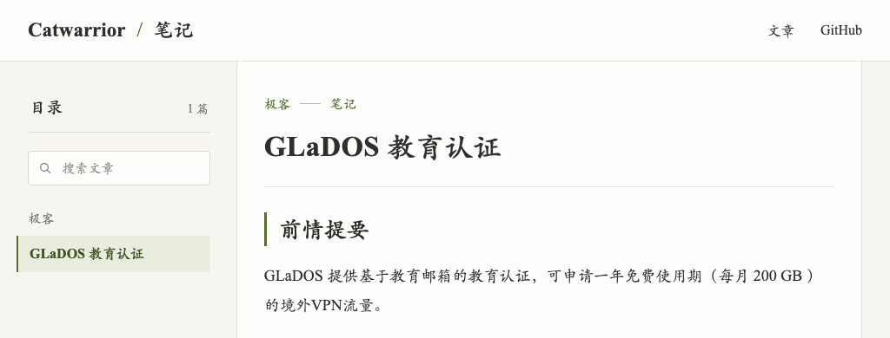

# Catwarrior · 笔记

**[打开笔记网站，阅读完整文章 →](https://avaivartika.github.io/catobs-public-notes/)**

这里保存已发布的 Markdown 文章及其图片等附件。网页提供文章列表、分类和搜索。

## 文章

- [GLaDOS 教育认证](https://avaivartika.github.io/catobs-public-notes/n/glados-education-certification/)

原文件位于 [notes](notes/) 目录。Obsidian 插件将标记的笔记同步到该目录后，GitHub Actions 自动更新网站。

标题使用 Georgia / 系统宋体，不再请求外部字体服务；正文与 Obsidian 一致，使用 Times New Roman / 楷体 SC，字号 18px；设备未安装楷体时使用随站点提供的 Fandol 楷体。代码块保留等宽字体。

每次部署同时生成 `index.json`，包含已发布文章的标题、摘要、日期、分类和链接。博客在访问时读取这份索引，新增、改名或删除笔记无需再部署博客。顶部导航和页脚提供返回博客的入口。

## 自动维护中英文列表

发布流程先提取笔记元数据，再使用 Helsinki-NLP/opus-mt-zh-en（赫尔辛基大学，CC-BY-4.0）自动翻译标题、摘要与分类，写入 `index.json` 的 `titleEn`、`descriptionEn`、`tagsEn`。原始 Markdown 和正文 HTML 不变。只需继续发布中文笔记，无需填写英文 frontmatter。

翻译在 GitHub Actions CPU 上运行，不需要 API 密钥。按中文源内容的哈希复用上次已发布译文，修改后自动重译；模型权重也会缓存。翻译失败时部署停止，保留上一版完整站点，避免发布半份双语数据。首次下载模型会增加发布时间。机器翻译可能存在术语误译。

模型来源及许可：https://huggingface.co/Helsinki-NLP/opus-mt-zh-en

笔记列表日期优先读取同步时携带的 `created`（源文件创建时间），其次为 `date`；历史笔记缺少此字段时才回退到首次加入 Git 的时间，不再使用最新提交时间。摘要优先采用 `description`；否则使用开篇介绍或章节主题，不再拼接操作步骤里的代码与端口。

### 笔记首页

首页采用与博客一致的灰米色、铜色标识与细线索引排版，按创建时间排列笔记。支持标题和简介搜索、分类筛选，以及 `⌘/Ctrl + K` 聚焦搜索；文章正文保留楷体阅读样式，页首与页尾可返回博客。

文章侧栏按笔记路径生成可折叠的多层文件树，支持全部展开/折叠、搜索自动展开、当前文章定位。拖动侧栏右边界调整宽度，双击恢复默认宽度，或聚焦分隔线后用左右方向键调整；顶部按钮可整体收起侧栏。宽度与折叠状态保存在当前浏览器中。

### 英文链接

`npm run build` 依次提取元数据、自动翻译、生成网站。英文标题统一转换为小写连字符路径，例如 `GLaDOS Education Certification` → `/n/glados-education-certification/`。同名路径自动附加来源路径摘要以避免覆盖；无法生成有效英文路径时构建失败。

目录、搜索、文章内链、canonical、sitemap 和博客索引共用该路径。中文目录和文件名只用于源笔记组织，不参与网页地址。修改英文标题会重新生成地址；不生成中文旧页面或跳转页。正文保持原文。

本地构建需安装 `scripts/translation-requirements.txt` 中的依赖和 PyTorch；GitHub Actions 自动安装。`.cache/listing.json` 是本次构建的中间数据，不提交到仓库。

### 字体加载

发布时从 Fandol 楷体原文件为每个页面提取实际使用的字形，输出带内容哈希的 WOFF2，并在 HTML 头部预加载。页面无需下载整套中文字体。访客阅读过的页面字体由 Service Worker 缓存（最多 32 个），正文 HTML 始终走网络；内容新增字形后会自动生成新的字体地址。首次访问仍需下载小字体包，后续访问可复用缓存。
